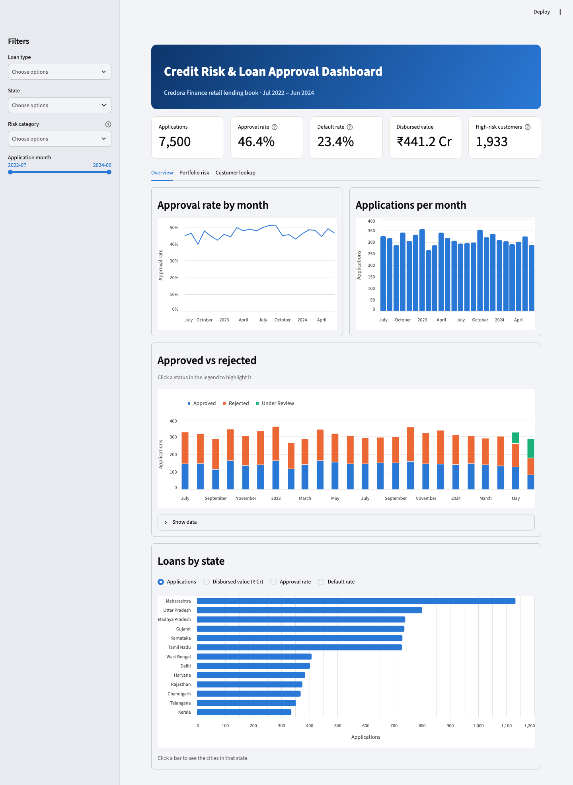
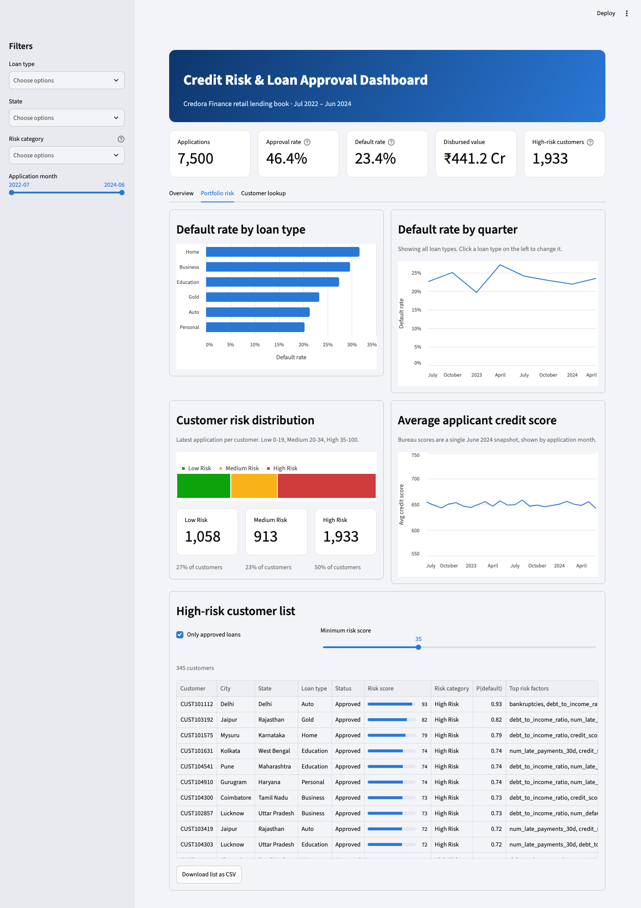
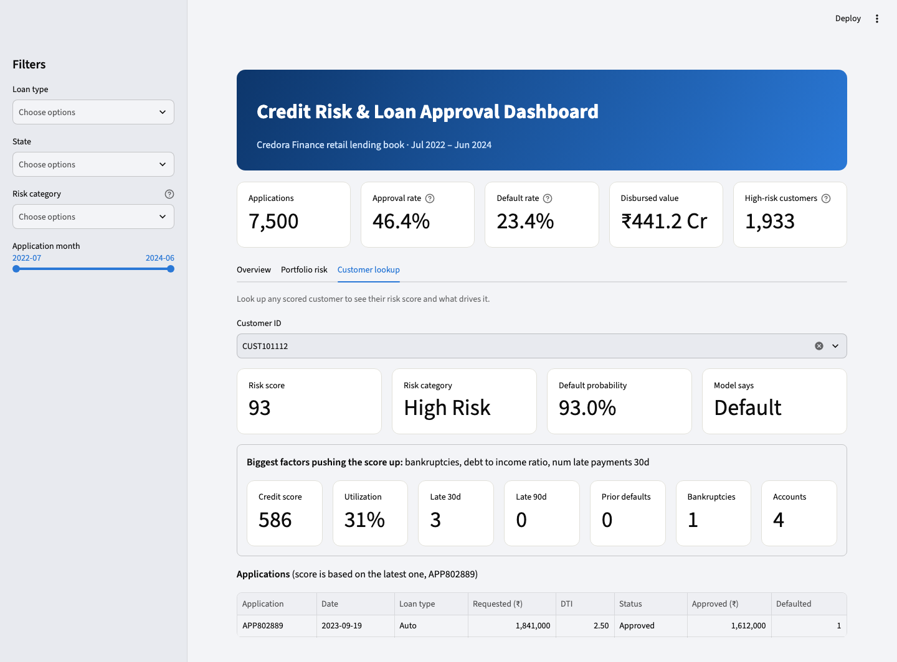

# Credit Risk & Loan Approval Analytics

A project that predicts which loans are likely to default and gives every customer a simple
0-100 risk score, with a dashboard to explore it all.



## The problem

A lender (Credora Finance, a made up company) gives out personal, home, auto, education, business
and gold loans in 20 Indian cities. When a loan application comes in they need to answer two things:

1. Should we approve it?
2. If we do, how likely is it that the person won't pay it back?

Right now they mostly look at the credit score and go with the underwriter's gut feeling.
This project uses their data to give a second opinion: a default probability and a risk score
for each customer.

## The data

Four CSV files, all linked by `customer_id`:

| File | What's in it | Rows |
|---|---|---|
| customers.csv | age, income, job, city, etc. | 5,000 |
| credit_history.csv | credit score, late payments, past defaults (one row per customer) | 5,000 |
| loan_applications.csv | each loan applied for, approved or not, and whether it defaulted | 7,500 |
| transactions.csv | 6 months of account transactions | 40,079 |

46% of applications got approved, and 23% of the loans that were given out defaulted.

## What I did, step by step

Each step has a script or notebook you can open and follow along.

**1. Load the data into a database** - `src/data_load.py`, `sql/schema.sql`
The CSVs go into PostgreSQL as four tables with keys and checks, so they can be joined and queried.

**2. Ask questions with SQL** - `sql/analysis.sql`, notes in `documentation/sql_insights.md`
10 queries like "what's the default rate per loan type?" and "who looks high risk?".

**3. Clean the data** - `notebooks/00_data_cleaning.ipynb`
Checked for duplicates, missing values, wrong dates and outliers. The data was mostly clean,
a few things got fixed when building features (e.g. age at the time of the application instead of today).

**4. Explore** - `notebooks/01_eda.ipynb`
Charts showing what separates loans that defaulted from ones that didn't.
Debt-to-income and credit score stood out the most.

**5. Build features** - `notebooks/02_feature_engineering.ipynb`, `src/features.py`
Joined everything into one row per loan and added things like loan-to-income and 6-month cash flow.

**6. Train models** - `notebooks/03_modeling.ipynb`, `src/train.py`
Compared Logistic Regression, Decision Tree, Random Forest and XGBoost. Logistic Regression did best.

**7. Score customers** - `notebooks/04_risk_scoring.ipynb`, `src/risk_score.py`
Turned the model's probability into a 0-100 score:
Low (0-19), Medium (20-34) and High (35-100). Each score also lists the top 3 reasons behind it.

**8. Dashboard** - `dashboard/app.py`
A Streamlit app to explore approvals, defaults, risk and individual customers.

## Results

- **Best model:** Logistic Regression, ROC-AUC 0.74 (cross validation) and 0.71 on the test set.
- **Catches about 2 out of 3 defaulters** at the chosen threshold.
- **Biggest warning signs:** high debt-to-income, low credit score, recent late payments.
- **The risk bands work:** Low, Medium and High customers default about 11%, 28% and 50% of the time.

The target was ROC-AUC 0.80. I tried tuning, more models and different features but couldn't get past
about 0.74 with this data. More detail and limitations in [`models/model_card.md`](models/model_card.md).

## Dashboard

Three tabs: an overview of volumes and trends, portfolio risk with a high-risk watchlist, and a
customer lookup. You can filter by loan type, state, risk category and month, hover over charts,
and click a bar to drill down.





## How to run it

You need Python 3.10+ and PostgreSQL.

```bash
# 1. set up
git clone https://github.com/priyankavasavada/credit-risk-loan-analytics.git
cd credit-risk-loan-analytics
python3 -m venv .venv
source .venv/bin/activate
pip install -r requirements.txt
createdb credit_risk
```

On a Mac, XGBoost also needs `brew install libomp`.

**2. Add the data.** Put the four CSV files in the `datasets/` folder. They aren't in the repo
because they contain personal details (names, emails, phone numbers).

```bash
# 3. run everything, in this order
python src/data_load.py                  # load the CSVs into postgres
psql -d credit_risk -f sql/analysis.sql  # run the 10 SQL queries
python src/train.py                      # train the models, saves models/default_model.pkl
python src/risk_score.py                 # score the customers
streamlit run dashboard/app.py           # open the dashboard
```

Then open the notebooks in `notebooks/` from 00 to 04 to see the analysis.

## Folder structure

```
├── datasets/        the CSV files (not committed)
├── sql/             schema.sql and analysis.sql
├── notebooks/       00 cleaning -> 01 EDA -> 02 features -> 03 modelling -> 04 risk scoring
├── src/             data_load.py, features.py, train.py, risk_score.py
├── models/          saved model, results, feature importance, model card
├── dashboard/       streamlit app
└── documentation/   SQL notes and screenshots
```

## Tools

Python, pandas, scikit-learn, XGBoost, SHAP, PostgreSQL, Streamlit, Altair, Jupyter

## License

MIT, see [LICENSE](LICENSE).
